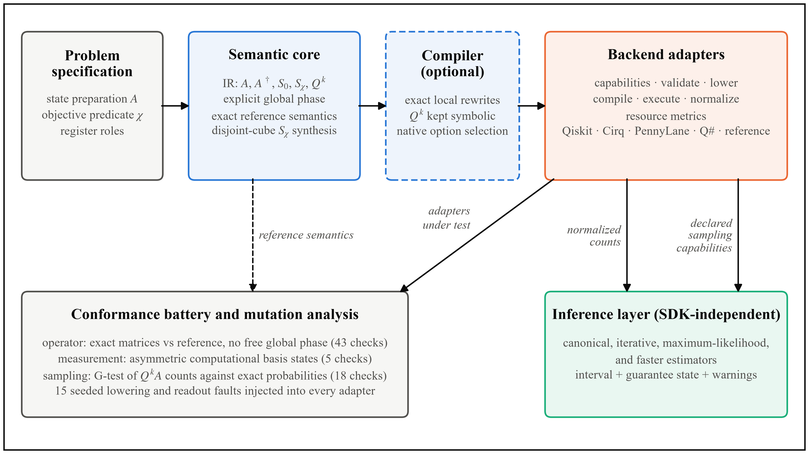

<p align="center">
  
</p>

<p align="center">
  <strong>Semantics-preserving quantum amplitude estimation across quantum SDKs</strong>
</p>

<p align="center">
  <a href="https://a-k-t-k.github.io/aeonq/"></a>
  <a href="https://www.python.org/downloads/"></a>
  <a href="#supported-backends"></a>
  <a href="docs/conformance_testing.md"></a>
  <a href="#development"></a>
  <a href="#development"></a>
  <a href="LICENSE"></a>
</p>

<p align="center">
  <a href="docs/quickstart.md">Quickstart</a> ·
  <a href="https://a-k-t-k.github.io/aeonq/">Documentation</a> ·
  <a href="examples/">Examples</a> ·
  <a href="docs/translator_fidelity.md">Translator study</a>
</p>

---

**aeonq** runs quantum amplitude estimation (QAE) on **Qiskit**, **Cirq**, **PennyLane**, and **Microsoft Q# (QDK)** without changing its meaning between them.

Porting a quantum algorithm is usually treated as gate-level translation. For amplitude estimation that is not enough. The Grover iterate $Q = -A S_0 A^\dagger S_\chi$ carries a global phase that becomes observable once $Q$ is controlled, and SDKs differ in endianness, phase conventions, query accounting, and how confidence intervals are derived. A translation can leave every measured distribution unchanged and still corrupt the estimate.

aeonq represents amplitude estimation in a semantic intermediate representation (IR) and lowers it to each SDK through adapters that are checked entry by entry against exact reference semantics. At runtime it decides which statistical guarantees apply to the backend in use.

## Highlights

- **Semantic IR.** $A$, $A^\dagger$, $S_0$, $S_\chi$, and $Q^k$ are first-class nodes with explicit global phase, exact symbolic adjoints, and one little-endian qubit convention on every target.
- **Structured oracle synthesis.** Boolean predicates compile to disjoint cubes; a threshold $x \ge K$ on an $m$-qubit register needs at most $m+1$ multi-controlled phase operations instead of basis-state enumeration.
- **One adapter contract.** Five adapters (Qiskit, Cirq, PennyLane, Q#, and an exact reference simulator) implement the same seven methods: capabilities, validation, lowering, compilation, execution, result normalization, and resource reporting.
- **Conformance battery.** 66 checks (43 operator, 5 measurement, 18 sampling) catch convention faults that count-based tests miss. Mutation analysis over 15 seeded lowering and readout faults detects every fault on all four SDKs.
- **Four estimators, one inference layer.** Canonical QAE, iterative (IQAE), maximum-likelihood (MLQAE), and Faster AE share SDK-independent inference and a uniform $2k+1$ query count.
- **Guarantees as runtime contracts.** A finite-sample guarantee is reported only when the backend declares ideal sampling; on a noise model or hardware it is withheld with a warning.
- **Independent verification.** Oracles in [`aeonq/oracles`](aeonq/oracles) (analytic amplitudes, hand-written circuits in each SDK, and a separate NumPy simulator) share no code with the IR, synthesis, reference simulator, or adapters.

### Why it matters

Running the same amplitude-estimation operators through 17 existing OpenQASM and pytket conversion paths, **152 of 702 translated programs differed from their source while passing a count-based check**, and **39 of 58 translated Grover operators changed the modal canonical grid estimate** (five evaluation qubits), typically from $\hat a$ to $1-\hat a$. See [Translator Fidelity & Oracles](docs/translator_fidelity.md).

## Architecture



| Layer | Responsibility |
|:---|:---|
| Problem specification | Declarative state preparation $A$, objective predicate $\chi$, and register roles (state, work, objective). |
| Semantic core | IR nodes, exact state-tensor reference semantics, and disjoint-cube phase-oracle synthesis. |
| Compiler (optional) | Unitary-preserving local rewrites with $Q^k$ kept symbolic; selects the cheapest native compiler configuration. |
| Backend adapters | Lower the IR to each SDK under the seven-method contract. |
| Conformance | 66-check battery and 15-fault mutation analysis against the reference semantics. |
| Inference | SDK-independent estimation, convergence, intervals, and guarantee qualification. |

## Installation

aeonq requires **Python 3.13+**. All dependencies are pinned in [`requirements-lock.txt`](requirements-lock.txt).

```bash
git clone https://github.com/A-K-T-K/aeonq.git
cd aeonq

python -m venv .venv
source .venv/bin/activate          # Windows: .venv\Scripts\activate

pip install -r requirements-lock.txt
pip install --no-build-isolation -e .
```

The translator-fidelity study additionally needs third-party circuit converters, pinned separately so the lockfile hash recorded in archived trials stays valid:

```bash
pip install -r requirements-translators.txt
```

## Quickstart

Estimate $a = \sin^2\theta = 0.25$ with iterative amplitude estimation on the exact reference simulator:

```python
from aeonq import estimate
from aeonq.adapters.reference import ReferenceAdapter
from aeonq.benchmarks.problems import bernoulli

case = bernoulli(0.25)

result = estimate(
    case.problem,
    algorithm="iqae",
    backend=ReferenceAdapter(),
    epsilon=0.02,
    alpha=0.05,
    shots_per_round=128,
    max_rounds=6,
    seed=42,
)

print(f"True amplitude:       {case.a_true:.6f}")
print(f"Estimate:             {result.estimate:.6f}")
print(f"Confidence interval:  {result.confidence_or_credible_interval}")
print(f"Oracle queries:       {result.total_oracle_queries}")
print(f"Guarantee status:     {result.guarantee_status}")
```

Run the same semantic problem on every SDK without rewriting a circuit:

```python
from aeonq import estimate
from aeonq.adapters.cirq import CirqAdapter
from aeonq.adapters.pennylane import PennyLaneAdapter
from aeonq.adapters.qiskit import QiskitAdapter
from aeonq.adapters.qsharp import QSharpAdapter
from aeonq.benchmarks.problems import bernoulli

problem = bernoulli(0.25).problem

for adapter in (QiskitAdapter(), CirqAdapter(), PennyLaneAdapter(), QSharpAdapter()):
    res = estimate(
        problem,
        algorithm="mlqae",
        backend=adapter,
        powers=(0, 1, 2),
        shots_per_power=64,
        seed=13,
    )
    print(f"{type(adapter).__name__:18s} estimate={res.estimate:.4f} shots={res.total_shots}")
```

Available algorithms: `iqae`, `mlqae`, `canonical_qae`, and `faster_ae`.

## Supported backends

| | Reference | Qiskit | Cirq | PennyLane | Microsoft Q# |
|:---|:---:|:---:|:---:|:---:|:---:|
| Adapter | `ReferenceAdapter` | `QiskitAdapter` | `CirqAdapter` | `PennyLaneAdapter` | `QSharpAdapter` |
| Pinned version | — | 2.5.2 | 1.7.0 | 0.45.1 | QDK 1.32.3 |
| Native program | IR state tensor | `QuantumCircuit` | `cirq.Circuit` | `QuantumScript` | Generated Q# source |
| Sampler | NumPy multinomial | `AerSimulator` | `cirq.Simulator` | `default.qubit` | `qsharp.run` |
| Unitary tolerance | $10^{-9}$ | $10^{-9}$ | $10^{-9}$ | $10^{-9}$ | $10^{-6}$ |
| Conformance | 66 / 66 | 66 / 66 | 66 / 66 | 66 / 66 | 66 / 66 |

Adapters reconcile each platform's conventions, such as PennyLane's opposite global-phase sign and the QDK's big-endian matrix order. The Q# tolerance reflects the six-digit precision of the QDK matrix export. Details are in [Platform Capabilities](docs/capabilities.md).

### Guarantee status

Every result reports one of the following in `result.guarantee_status`:

| Status | Meaning |
|:---|:---|
| `THEORETICAL_GUARANTEE_SATISFIED` | Converged to the requested width; the finite-sample interval holds under ideal sampling. |
| `THEORETICAL_GUARANTEE_NOT_APPLICABLE` | Would have converged, but the backend declares non-ideal sampling (noise model or hardware), so the guarantee is withheld and a warning attached. |
| `INSUFFICIENT_BUDGET` | The shot or round budget ran out before the requested width was reached. |
| `INCONCLUSIVE` | Observations were inconsistent with the feasible interval. |
| `EMPIRICAL_VALIDATION_ONLY` | Canonical QAE: the likelihood-ratio interval is asymptotic and carries no finite-sample guarantee. |

## Documentation

The full documentation is published at **[a-k-t-k.github.io/aeonq](https://a-k-t-k.github.io/aeonq/)**. It is built with [VitePress](https://vitepress.dev) from [`docs/`](docs/README.md) and deployed to GitHub Pages.

| Guide | Contents |
|:---|:---|
| [Quickstart](docs/quickstart.md) | Bernoulli estimation, threshold predicates, and cross-SDK execution. |
| [Platform Capabilities](docs/capabilities.md) | Capability matrix, the adapter contract, and convention reconciliation. |
| [Algorithms & Inference](docs/algorithms.md) | Estimator formulations, confidence intervals, Fisher information, and query accounting. |
| [Intermediate Representation](docs/intermediate_representation.md) | IR nodes, register semantics, disjoint-cube synthesis, and adjoints. |
| [Conformance Testing](docs/conformance_testing.md) | The 66-check battery, the 15 mutation operators, and certifying a custom adapter. |
| [Translator Fidelity & Oracles](docs/translator_fidelity.md) | Existing converters on AE operators, and the independent oracles. |

To build and preview the site locally:

```bash
npm ci
npm run docs:dev        # live server
npm run docs:build      # static build
```

## Verification

Run the complete test suite (unit, property, edge-case, regression, statistical, and integration). Translator-fidelity tests are skipped automatically when the converters from `requirements-translators.txt` are not installed.

```bash
python -m pytest
```

Run the conformance battery and the mutation-analysis evidence on their own:

```bash
python -m pytest tests/integration/test_conformance_battery.py tests/integration/test_mutation_evidence.py
```

Regenerate the translator-fidelity study and the independent-oracle checks:

```bash
python benchmarks/translator_fidelity.py
python benchmarks/independent_oracles.py
```

### Reproducibility

Every archived benchmark trial records its seed, a SHA-256 snapshot of the source that produced it (stored under [`benchmarks/results/archives/`](benchmarks/results/archives/README.md)), and the hash of `requirements-lock.txt`. The audit re-validates all records against the experiment manifest:

```bash
python -m benchmarks.pipeline.audit_reproducibility
```

The lockfile and the files under `benchmarks/results/` are stored byte-for-byte (see [`.gitattributes`](.gitattributes)); editing or re-encoding them invalidates the recorded hashes.

## Examples

The [`examples/`](examples/) directory contains self-contained scripts, all executed in CI:

| Script | Topic |
|:---|:---|
| [`01_basic_bernoulli.py`](examples/01_basic_bernoulli.py) | IQAE on a one-qubit Bernoulli problem |
| [`02_threshold_predicate.py`](examples/02_threshold_predicate.py) | Threshold predicate $x \ge K$ via disjoint cubes |
| [`03_compare_algorithms.py`](examples/03_compare_algorithms.py) | Canonical QAE, IQAE, MLQAE, and Faster AE side by side |
| [`04_compare_sdks.py`](examples/04_compare_sdks.py) | One problem on Qiskit, Cirq, PennyLane, and Q# |
| [`05_adaptive_scheduler.py`](examples/05_adaptive_scheduler.py) | Adaptive power scheduling |
| [`06_alias_recovery.py`](examples/06_alias_recovery.py) | Resolving phase aliasing at higher Grover powers |
| [`07_boundary_amplitudes.py`](examples/07_boundary_amplitudes.py) | Numerical behaviour as $a \to 0$ and $a \to 1$ |
| [`08_checkpoint_resume.py`](examples/08_checkpoint_resume.py) | Checkpointing and resuming an interrupted run |
| [`09_compiler_resources.py`](examples/09_compiler_resources.py) | Depth, two-qubit counts, and multi-controlled decompositions |
| [`10_digital_option_case_study.py`](examples/10_digital_option_case_study.py) | Digital option pricing on a log-normal asset |
| [`11_resource_report.py`](examples/11_resource_report.py) | Cross-SDK resource reports |

## Repository layout

```text
aeonq/
├── adapters/       Backend adapters: Qiskit, Cirq, PennyLane, Q#, reference
├── algorithms/     Canonical QAE, IQAE, MLQAE, Faster AE
├── compiler/       AE-aware rewrites and native compiler selection
├── conformance/    Conformance battery, mutation engine, translator-fidelity study
├── inference/      Binomial intervals, likelihoods, Fisher information
├── ir/             IR nodes, registers, objective predicates
├── oracles/        Independent oracles that share no code with the core
├── runtime/        Results, async execution, checkpoints
├── scheduling/     Fixed and adaptive power schedules
└── synthesis/      Disjoint-cube oracles, reflections, Grover expansion
benchmarks/         Studies, experiment manifest, processing pipeline, and results
docs/               VitePress documentation
examples/           Runnable examples
scripts/            Documentation and example validators
tests/              Unit, property, edge-case, regression, statistical, integration
```

## Development

The CI workflow runs the same checks on every push:

```bash
python -m ruff check aeonq tests benchmarks scripts examples --select F
python -m ruff format --check aeonq tests benchmarks scripts examples
python -m mypy aeonq
python -m pytest
python scripts/validate_examples.py
python scripts/validate_docs.py
```

## License

Released under the [MIT License](LICENSE).
